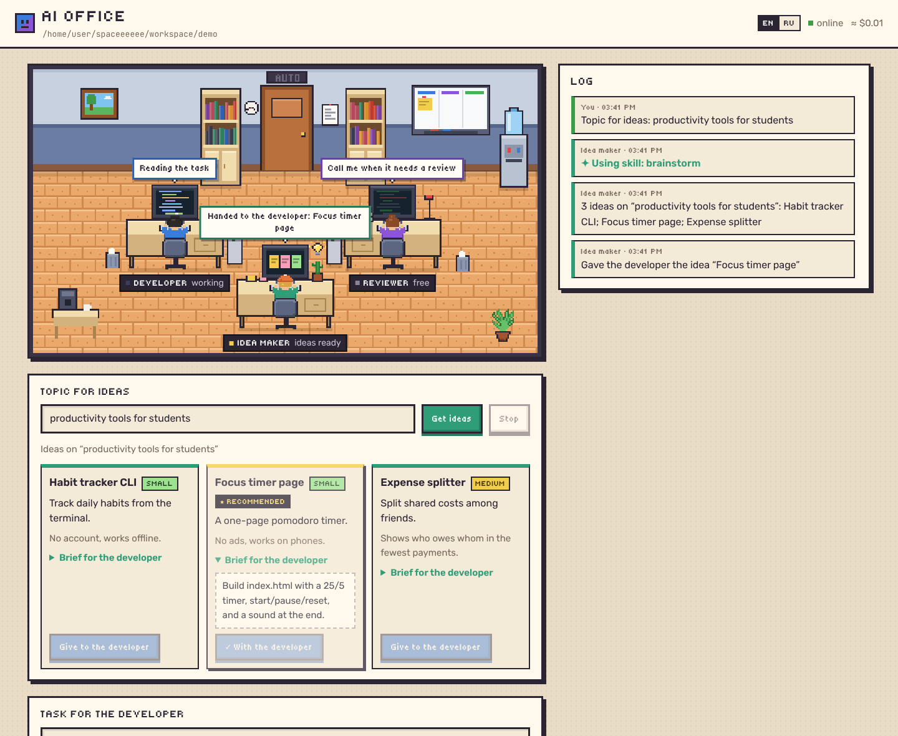
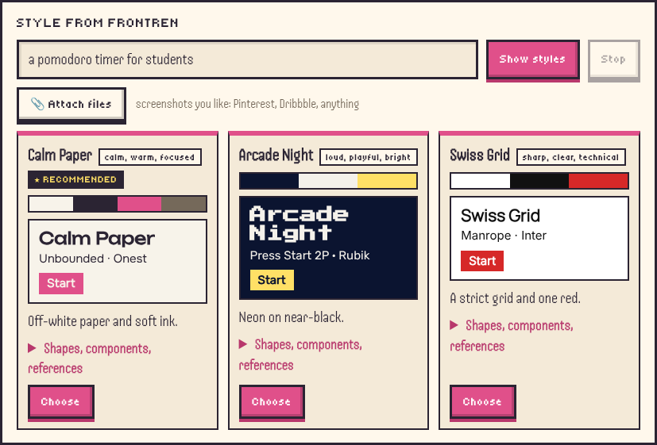
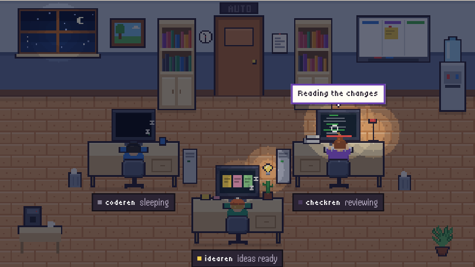
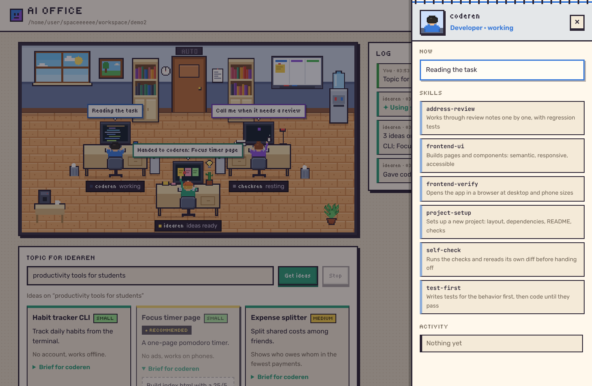

# Rens Office + ai-review

[Русская версия](README.ru.md)

Two tools built on Claude that run on a **Claude subscription (Pro or Max), with no API key**:

- **Rens Office** is a pixel-art web office with four agents: **idearen** proposes what to build on a topic you give, **backren** builds the backend (data, APIs, logic), **frontren** builds the frontend (pages, components, style), and **checkren** reviews their work when you ask, or on its own with the autopilot, and sends it back for fixes.
- **ai-review** is a command-line reviewer: it checks a diff, gives a verdict of APPROVED or CHANGES REQUESTED, and sets the exit code for CI.



## Install

You need Python 3.11+ and [Claude Code](https://code.claude.com), signed in with an account that has a subscription:

```bash
claude
```

```bash
pip install -e ".[dev]"
```

## Rens Office

```bash
ai-office
```

Then open http://127.0.0.1:8000, and create a project or open one (see [Projects](#projects)).

1. **Give task.** Pick who gets it above the task, **backren** or **frontren**. The developer works in the project's folder: it creates and edits files and runs commands. Its speech bubble and the log show what it is doing right now.
2. **Call checkren.** checkren, the reviewer, looks at everything the developers changed since the task started, runs the checks from `.ai-review.toml`, and gives a verdict. It can read files but never change them.
3. **Send back.** The notes go to the developer who had the task, who continues its own conversation (`claude --resume`), so it remembers the task and its code.
4. **Accept.** The current state is committed to git, and the next task starts from it.

If the folder does not exist, it is created with a git repository. The office makes its own commits: `office: before task` before the first task and `office: accepted: …` when you accept.

### Two developers

backren and frontren share the project's folder, so one of them works at a time, and each keeps its own conversation. Give backren the API and then frontren the page: until you accept, both are one change for checkren, and the developer who picks up the other's work first hears that developer's report, so frontren learns which endpoints backren made. backren keeps the contract in `API.md`; frontren builds against it, with mock data where an endpoint is still missing, and follows `DESIGN.md` when the project has one.

### idearen, the idea maker

Write a topic under **Topic for idearen** and press **Get ideas**. idearen looks at the project, loads its skills and proposes 3 to 5 ideas, each with a pitch, why it is worth building, its scope (small, medium or large) and a complete brief. One is marked recommended.

idearen also says who should start each idea, **→ backren** or **→ frontren**, and describes an idea's interface for frontren: its screens, the main flow, the states and the mood. It leaves the colors and fonts to frontren.

**Give to frontren** (or backren) hands an idea over as the next task, and a sticky note flies to that desk; **or to …** gives it to the other developer instead. idearen only reads files and may use web search, so it can think while the others work. Asking again continues its conversation, so you get new ideas instead of the same ones.

### Styles from frontren

Before frontren builds an interface, let it propose a look. Write what the product is and who it is for under **Style from frontren**, or leave it empty for the current project, attach screenshots you like from Pinterest, Dribbble or anywhere, and press **Show styles**. frontren looks at your files, the project and a few design galleries on the web, then proposes three directions that differ in mood. Each has a palette, a heading and a body font from Google Fonts, shapes, components, the references it used and why it fits, and its card shows a small preview in those colors and fonts.



**Choose** writes that direction into the project's `DESIGN.md`, which frontren follows from then on; edit the file to adjust the style. Looking for styles only reads, so backren can work meanwhile. Asking again gives new directions rather than the same ones.

**Figma.** frontren reads Figma designs when your Claude Code has Figma connected: the Figma connector of your Claude account, or this command and then `/mcp` in Claude Code to sign in:

```bash
claude mcp add --transport http figma https://mcp.figma.com/mcp
```

Put a figma.com link in a task or a style brief, and frontren builds from that design instead of drawing from scratch. Only such a run connects to Figma, and it gets only Figma's reading tools, never the ones that change your files. Figma limits these calls on its free plan.

### Autopilot

Turn on **Autopilot** and the loop runs by itself: new ideas send the recommended one to the developer idearen picked when the office is free, the developer finishes, the reviewer is called, and rejected work goes back for fixes, up to the round limit you set. It stops when checkren approves, when the limit is reached, on an error, or when you press Stop. Accepting the work always stays with you. The **AUTO** sign above the door lights up while it runs.

### Day and night

The office follows your clock: dawn, day, evening and night, with the sky in the window and the light in the room. The **AUTO / DAY / NIGHT** switch in the header pins one of them.

An agent with nothing to do starts resting after a few seconds, each in its own way:

| Agent | When it rests |
|---|---|
| backren | listens to music in its headphones, sips coffee, stretches, naps |
| frontren | sketches in a sketchbook, sips coffee, stretches, naps |
| checkren | reads a book, sips tea, stretches, naps |
| idearen | daydreams, juggles a ball, sips soda, stretches, naps |

At night the agents with nothing to do fall asleep: their screens go dark and Zs float up. Whoever has work keeps going by the light of the monitor and the desk lamp.



### Skills

Each agent has its own skills: Claude Code skills, loaded only into that agent's runs as a plugin (`--plugin-dir`). Click an agent or its name plate to open its drawer with its skills, the skill in use, and its own activity.



| Both developers | What it does |
|---|---|
| `test-first` | Writes tests for the behavior first, then code until they pass |
| `project-setup` | Sets up a new project: layout, dependencies, README, checks |
| `debugging` | Finds the root cause first and keeps its reproduction as a regression test |
| `address-review` | Works through review notes one by one, with regression tests |
| `self-check` | Runs the checks and rereads its own diff before handing off |

| backren (backend) | What it does |
|---|---|
| `api-design` | Designs the endpoints and keeps `API.md`, the contract frontren builds against |
| `data-model` | Stores data safely: schema, migrations, parameterized queries, transactions |

| frontren (frontend) | What it does |
|---|---|
| `frontend-design` | Gives the interface a distinct, deliberate look instead of a template ([Anthropic's skill](https://github.com/anthropics/skills), Apache 2.0) |
| `frontend-ui` | Builds pages and components: semantic, responsive, accessible, safe rendering |
| `frontend-verify` | Opens the app in a real browser at desktop and phone sizes |
| `design-directions` | Finds references and proposes distinct styles to choose from |

| checkren (reviewer) | What it does |
|---|---|
| `edge-cases` | Hunts for inputs that break the code |
| `test-review` | Checks whether the tests would catch a broken implementation |
| `security-review` | Looks for injection, path traversal, leaked secrets |
| `frontend-review` | Checks UI code: unsafe rendering, accessibility, layout, states |
| `verify-fixes` | On a re-review, checks that each earlier note is really fixed |

| idearen (idea maker) | What it does |
|---|---|
| `brainstorm` | Generates many raw ideas, then keeps a few distinct, buildable ones |
| `market-check` | Checks what already exists and finds what is missing |
| `write-brief` | Writes a brief the developer can build from without questions |
| `ui-brief` | Describes the screens, flow and mood for frontren, and leaves the style to it |

The skills live in `office/skills/<plugin>/skills/<name>/SKILL.md`, in five plugins: `developer` (both developers), `backend`, `frontend`, `reviewer` and `ideator`. To add one, create a folder with a `SKILL.md` there; its `description` tells the agent when to use it. A label for the page in each language can go in `office/i18n.py` as `skill_<name>`.

### Files

Give the agents files along with a task or a topic: a design, a brief as a PDF, a data set, a logo. Use **📎 Attach files**, drop them onto the form, or paste a screenshot into the text box (up to 20 MB each). They are kept in the project's `.rens-office/uploads/`, which is never committed or reviewed, and the agent gets their paths and opens them with Read, which shows images and PDFs too. The developers copy into the project only what the project needs.

### Model and effort

Each agent's drawer has a **Model** list (Haiku, Sonnet, Opus, Fable) and an **Effort** list (`low` to `max`), so idearen can think on a cheap model while frontren builds on a strong one. A choice applies from the agent's next run and is kept in `~/.rens-office.json`. **auto** means `--model` or `--effort` from the command line, else Claude Code's default; checkren's effort on auto is the project's `effort`, else `high`. If Claude Code answers "You're out of usage credits", that model needs usage credits on your plan: pick another one.

### Projects

The office opens on the project list. Each project is a folder in `Documents/Rens Projects` (`--projects` picks another folder): create one, open one, or open a folder from elsewhere, and **◂ Projects** in the header goes back to the list once no agent is working. `--workspace DIR` opens a folder right away instead.

A project remembers where it stands. Everything the developers make stays in the folder with its git history, and the office keeps the rest in the folder's `.rens-office/`, which is never committed: the task, the verdict, idearen's ideas, the log and the tasks accepted so far, plus `summary.md`, a page to read on where the project is. Reopen it and all of it is back. Each developer then starts a new conversation that gets the list of accepted tasks, and for a rework the current task too; idearen is told which ideas it already gave. A new conversation with these notes costs less than resuming a long one, and it works after the folder moves to another computer.

The office won't open a drive, your home folder or the projects folder itself as a project, since it commits every file in a project.

To work on an existing repository, such as your team's, open your clone as a project and switch to a branch of your own first. The office commits on the current branch under your git name (`user.name` and `user.email` in git's settings), or as "Rens Office" when git has none, and never pushes. Keep secrets such as `.env` in `.gitignore`: the office commits every file git does not ignore.

### Options

| Flag | What it does |
|---|---|
| `--projects DIR` | folder that holds the projects, default `Documents/Rens Projects` |
| `--workspace DIR` | open this project folder at start, instead of the project list |
| `--port N` | port, default 8000 |
| `--host ADDR` | address to listen on, default `127.0.0.1` |
| `--allow-host NAME` | another name the page may be opened by, such as a Tailscale name (repeatable) |
| `--lang en\|ru` | language of the page and the agents, default `en`; the page also has an EN/RU switch |
| `--model M` | model for the agents left on auto in their drawer, for example `opus` or `claude-haiku-5-5` |
| `--effort` | `low` / `medium` / `high` / `xhigh` / `max`, for the agents left on auto |
| `--no-bash` | do not let the developers run shell commands; checks from `.ai-review.toml` are skipped too, since the developers can edit that file |
| `--no-skills` | run the agents without the office's skills |

**Safety.** The developers can run commands on your computer; `--no-bash` turns that off. The idea maker may read web pages, so its briefs are untrusted text: each brief tells the developer to stay in the project folder and not to download, install or send anything, but that is an instruction, not a sandbox. frontren reads web pages too when it looks for styles; you see a direction before you choose it, and frontren takes only the look from `DESIGN.md`. With the autopilot on, a brief reaches a developer before you read it; use `--no-bash` or keep the autopilot off when that matters. Because the developers can run commands, the server listens only on `127.0.0.1` and rejects requests from other sites: it checks `Host` and `Origin` and accepts only JSON. The page opens only by `localhost`, by the address given to `--host`, or by a name given to `--allow-host`; any other name is refused, so a site that points its own domain at your computer gets nothing. Do not expose it to a network unless you need to.

**Limits.** Each task and each review uses your subscription limits. The bars in the header show how much of the 5-hour and the weekly limit is used, as Claude Code reports it. To fill them at start, the office makes one tiny request to the smallest model (about 1,500 tokens); after that every agent run updates them, and a click on them checks again. Hover over a bar to see when it resets. `/usage` in Claude Code shows the same. The dollar amount next to them is Claude Code's estimate, not a charge.

### How the office saves your limits

- **Failing checks skip the model review.** If the project's checks fail, the work goes back with their output right away, without a reviewer run: the code will change anyway. Turn this off with `fast_fail = false` in `.ai-review.toml`.
- **New files are sent once.** Their content is already in the diff, so it is not repeated in the review prompt.
- **A re-review gets the previous notes** and the developer's reply to them, and checks each one instead of starting from scratch.
- **No MCP servers you don't need.** Claude Code connects every MCP server you set up, and their tool descriptions fill each run's context. The agents run without them (`--strict-mcp-config`); only a frontren run with a figma.com link gets the servers, and of their tools only Figma's reading ones.
- **Caches stay out.** `__pycache__`, `node_modules`, virtualenvs and the like go into the repository's local exclude file, so they are never reviewed or committed.
- The reviewer starts fresh for each review and only reads files; each developer keeps its own conversation, so fixes do not repeat context.

## ai-review

```bash
ai-review --check "pytest -q"
```

```bash
ai-review --base main
```

```bash
ai-review --files src/api.py
```

The code makes the verdict, not the model: a change is not approved if any check fails or there is a `critical` or `major` note. `minor` and `nit` notes are shown but do not block.

| Flag | What it does |
|---|---|
| `--base REF` | review the diff from the merge base with a branch or commit |
| `--files ...` | review whole files instead of a diff |
| `--check CMD` | a check command; can be given several times |
| `--no-checks` | skip the checks from `.ai-review.toml` |
| `--backend` | `claude-code` (default, uses your subscription) or `api` (uses `ANTHROPIC_API_KEY`) |
| `--model`, `--effort` | model and reasoning depth |
| `--json` | print JSON |

Exit codes: `0` approved, `1` changes requested, `2` error.

- **`claude-code`** runs `claude -p` with a JSON schema for the answer and read-only tools (`Read`, `Grep`, `Glob`), so the reviewer can open other files, such as callers or tests. It needs Claude Code to be signed in; for CI there is the token from `claude setup-token`.
- **`api`** uses the Claude API (`claude-opus-5-5`) with structured output and server-side fallback. It needs `ANTHROPIC_API_KEY`.

## Project settings

Both tools read `.ai-review.toml` in the project root:

```toml
checks = ["pytest -q", "ruff check ."]
effort = "high"
fast_fail = true
instructions = """
We use FastAPI. Every endpoint validates its input with pydantic.
"""
```

## How it is built

```
reviewer/
  context.py      collects the diff and changed files, runs the checks
  llm.py          reviewer prompt, answer schema, verdict, the api and claude-code backends
  claude_code.py  runs `claude -p` and streams its stream-json events
  processes.py    ends a command together with everything it started
  cli.py          the ai-review command
office/
  agents.py       the office: idea maker, two developers, reviewer, autopilot, skills, git snapshots, its memory
  projects.py     the project list and the project the office has open
  ideator.py      the idea maker's prompt and the schema of its ideas
  designer.py     frontren's style directions and DESIGN.md
  i18n.py         English and Russian texts of the office
  server.py       HTTP server and the event stream (SSE) for the page
  skills/         the agents' skills as Claude Code plugins
  static/         the page: scene.js draws the pixel office, app.js runs the interface
```

## Tests

```bash
python -m pytest -q
```

The tests call neither the API nor Claude Code: `tests/fake_claude.py` stands in for `claude`.
