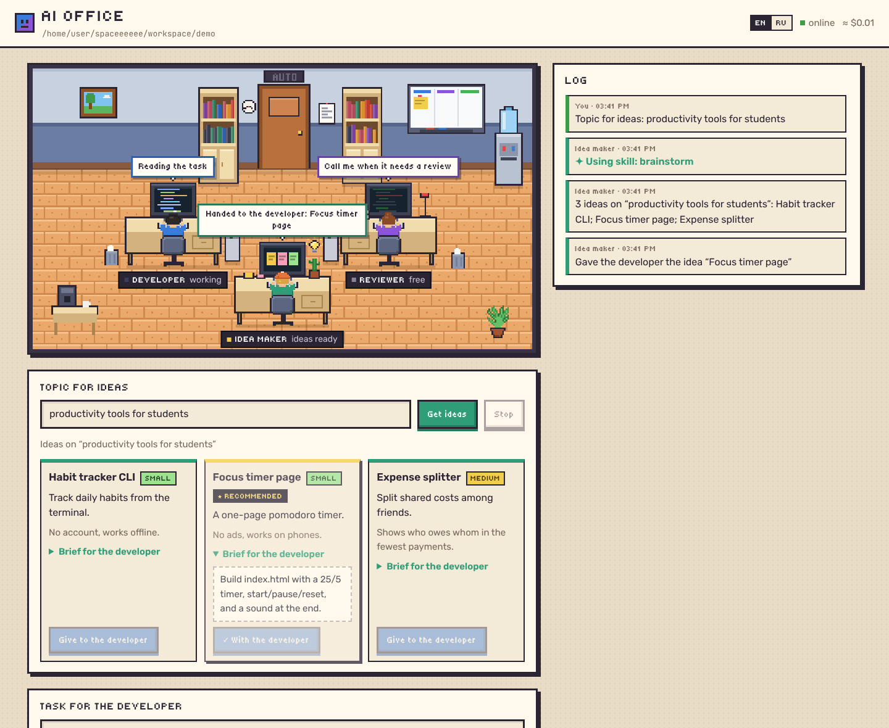
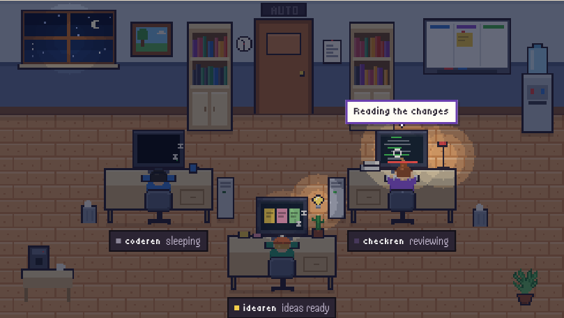
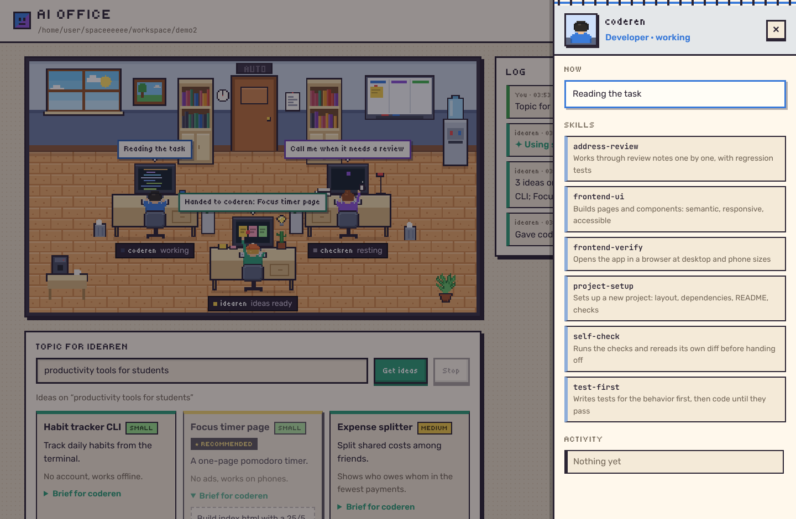

# Rens Office + ai-review

[English version](README.md)

Два инструмента на Claude, которые работают **через подписку Claude (Pro/Max), без API‑ключа**:

- **Rens Office** — пиксельный веб‑офис с тремя агентами. **idearen** предлагает, что сделать, по теме, которую ты задал. **coderen** пишет код. **checkren** проверяет его по кнопке или сам, в режиме автопилота, и отправляет работу на доработку.
- **ai-review** — ревьюер для командной строки: проверяет diff, выносит вердикт APPROVED или CHANGES REQUESTED и возвращает код выхода для CI.



## Установка

Нужны Python 3.11+ и [Claude Code](https://code.claude.com), в котором выполнен вход аккаунтом с подпиской:

```bash
claude
```

```bash
pip install -e ".[dev]"
```

## Rens Office

```bash
ai-office --workspace ./my-project --lang ru
```

Открой http://127.0.0.1:8000.

1. **Дать задачу.** coderen, исполнитель, работает в папке `--workspace`: создаёт и правит файлы, запускает команды. Что происходит прямо сейчас, видно в пузыре над столом и в журнале.
2. **Позвать checkren.** checkren, ревьюер, смотрит все изменения с начала задачи, запускает проверки из `.ai-review.toml` и выносит вердикт. Файлы можно только читать, но не менять.
3. **На доработку.** Замечания уходят coderen. Разговор продолжается (`claude --resume`), поэтому задача и код никуда не теряются.
4. **Принять.** Текущее состояние фиксируется коммитом в git, и следующая задача начинается с него.

Если папки нет, она создаётся вместе с git‑репозиторием. Офис сам делает коммиты: `office: before task` перед первой задачей и `office: accepted: …` при принятии.

### idearen, генератор идей

Напиши тему в поле **Тема для idearen** и нажми **Придумать идеи**. idearen посмотрит на рабочую папку, подключит свои навыки и предложит 3–5 идей. У каждой есть описание, польза, объём работы (небольшая, средняя или большая) и полное ТЗ для coderen. Одна идея отмечена как рекомендуемая.

Кнопка **Передать coderen** отдаёт идею как следующую задачу, и через комнату летит стикер. idearen только читает файлы и может искать в интернете, поэтому думает, пока другие работают. Если спросить ещё раз, разговор продолжится и появятся новые идеи, а не старые.

### Автопилот

Включи **Автопилот**, и цикл пойдёт сам: когда появляются новые идеи, рекомендуемая уходит исполнителю, если офис свободен; исполнитель закончил, ревьюер вызван, отклонённая работа уходит на доработку, пока не кончится лимит раундов, который ты задал. Автопилот останавливается, когда работа одобрена, когда исчерпан лимит, при ошибке или по кнопке «Стоп». Принять работу всегда решаешь ты. Пока автопилот работает, над дверью горит вывеска **AUTO**.

### День и ночь

Офис живёт по твоим часам: рассвет, день, вечер и ночь, с небом в окне и светом в комнате. Переключатель **АВТО / ДЕНЬ / НОЧЬ** в шапке закрепляет одно из них.

Агент, которому нечего делать, через пару секунд начинает отдыхать, и у каждого свои занятия:

| Агент | Как отдыхает |
|---|---|
| coderen | слушает музыку в наушниках, пьёт кофе, потягивается, дремлет |
| checkren | читает книгу, пьёт чай, потягивается, дремлет |
| idearen | мечтает, жонглирует мячиком, пьёт газировку, потягивается, дремлет |

Ночью свободные агенты засыпают: экраны гаснут, над головами летят «Z». Тот, у кого есть работа, продолжает при свете монитора и настольной лампы.



### Навыки

У каждого агента свои навыки. Это навыки Claude Code, которые подключаются плагином (`--plugin-dir`) только к запускам этого агента. Нажми на агента или на его табличку, и выдвинется шторка: его навыки, навык, который он применяет сейчас, и его действия.



| coderen (исполнитель) | Что делает |
|---|---|
| `test-first` | Сначала пишет тесты на поведение, потом код, пока тесты не пройдут |
| `project-setup` | Создаёт проект: структура, зависимости, README, проверки |
| `frontend-ui` | Верстает страницы и компоненты: семантично, адаптивно, доступно, без небезопасного вывода |
| `frontend-verify` | Открывает приложение в настоящем браузере на размерах десктопа и телефона |
| `address-review` | Разбирает замечания по одному и добавляет регрессионные тесты |
| `self-check` | Перед сдачей запускает проверки и перечитывает свой diff |

| checkren (ревьюер) | Что делает |
|---|---|
| `edge-cases` | Ищет входные данные, которые ломают код |
| `test-review` | Проверяет, поймают ли тесты сломанную реализацию |
| `security-review` | Ищет инъекции, выход за пределы папки, утечки секретов |
| `frontend-review` | Проверяет UI: небезопасный вывод, доступность, вёрстку, состояния |
| `verify-fixes` | При повторном ревью проверяет, что каждое прошлое замечание исправлено |

| idearen (генератор идей) | Что делает |
|---|---|
| `brainstorm` | Набрасывает много сырых идей и оставляет несколько разных и выполнимых |
| `market-check` | Проверяет, что уже существует, и находит, чего не хватает |
| `write-brief` | Пишет ТЗ, по которому исполнитель сделает работу без вопросов |

Навыки лежат в `office/skills/<роль>/skills/<имя>/SKILL.md`. Чтобы добавить свой, создай там папку с `SKILL.md`; поле `description` подсказывает агенту, когда навык применять. Подпись для страницы на каждом языке можно добавить в `office/i18n.py` как `skill_<имя>`.

### Модель и effort

В шторке каждого агента есть список **Модель** (Haiku, Sonnet, Opus, Fable) и список **Effort** (от `low` до `max`): например, idearen думает на дешёвой модели, а coderen пишет код на сильной. Выбор действует со следующего запуска агента и сохраняется в `~/.rens-office.json`. **Авто** значит `--model` или `--effort` из командной строки, а без них — как в Claude Code; effort у checkren на «авто» берётся из `effort` проекта, иначе `high`. Если Claude Code отвечает «You're out of usage credits», этой модели на твоём тарифе нужны кредиты: выбери другую.

### Проекты

Проект — это папка `--workspace`. Всё, что сделал coderen, остаётся в ней и после остановки офиса, вместе с историей git. Чтобы вернуться к проекту, запусти офис с той же папкой; для нового проекта дай новую папку. Только пока офис запущен, живут разговор coderen, вердикт, идеи idearen и журнал. После перезапуска coderen начинает новый разговор и заново читает файлы.

Принимай работу перед тем, как останавливать офис. Первая задача после запуска коммитит всё, что лежит в папке, как `office: before task`, и непринятые изменения уже не попадут в то, что проверяет checkren.

Чтобы работать в существующем репозитории, например командном, укажи в `--workspace` свой клон и сначала переключись на свою ветку. Офис коммитит в текущую ветку от твоего имени в git (`user.name` и `user.email` в настройках git), а если они не заданы — от имени «Rens Office», и ничего не пушит. Секреты вроде `.env` держи в `.gitignore`: офис коммитит все файлы, которые git не игнорирует.

### Флаги

| Флаг | Что делает |
|---|---|
| `--workspace DIR` | папка проекта, по умолчанию `./workspace` |
| `--port N` | порт, по умолчанию 8000 |
| `--host ADDR` | адрес, на котором слушать, по умолчанию `127.0.0.1` |
| `--allow-host NAME` | ещё одно имя, по которому можно открыть страницу, например имя в Tailscale (можно несколько раз) |
| `--lang en\|ru` | язык страницы и агентов, по умолчанию `en`; на странице есть переключатель EN/RU |
| `--model M` | модель для агентов, у которых в шторке стоит «авто», например `opus` или `claude-haiku-5-5` |
| `--effort` | `low` / `medium` / `high` / `xhigh` / `max` для агентов на «авто» |
| `--no-bash` | запретить исполнителю запускать команды; проверки из `.ai-review.toml` тоже пропускаются, ведь исполнитель может изменить этот файл |
| `--no-skills` | запустить агентов без навыков офиса |

**Безопасность.** Исполнитель может запускать команды на твоём компьютере (это отключается флагом `--no-bash`). Генератор идей может читать сайты, поэтому его ТЗ — непроверенный текст. В каждом ТЗ исполнителю сказано работать только в папке проекта и ничего не скачивать, не устанавливать и не отправлять, но это инструкция, а не песочница. С включённым автопилотом ТЗ попадает к исполнителю раньше, чем ты его прочитаешь; если это важно, используй `--no-bash` или не включай автопилот. Раз исполнитель может запускать команды, сервер слушает только `127.0.0.1` и отклоняет запросы с чужих сайтов: проверяет `Host` и `Origin` и принимает только JSON. Страница открывается только по `localhost`, по адресу из `--host` или по имени из `--allow-host`; другие имена отклоняются, поэтому сайт, который направил свой домен на твой компьютер, ничего не получит. Не открывай его в сеть без необходимости.

**Лимиты.** Каждая задача и каждое ревью расходуют лимиты подписки. Полоски в шапке показывают, сколько потрачено из 5‑часового и недельного лимита, по данным Claude Code. Чтобы показать их сразу, при запуске офис делает один крошечный запрос к самой маленькой модели (около 1 500 токенов); потом их обновляет каждый запуск агента, а клик по ним проверяет заново. Наведи на полоску, чтобы увидеть время сброса. То же самое показывает `/usage` в Claude Code. Сумма в долларах рядом — оценка Claude Code, а не списание.

### Как офис экономит лимиты

- **Упавшие проверки не тратят ревью.** Если проверки проекта не проходят, работа сразу возвращается с их выводом, без запуска ревьюера: код всё равно изменится. Отключается строкой `fast_fail = false` в `.ai-review.toml`.
- **Новые файлы отправляются один раз.** Их содержимое уже есть в diff, поэтому в промпт ревью оно не дублируется.
- **Повторное ревью получает прошлые замечания** и ответ coderen на них и проверяет каждое, а не начинает с нуля.
- **Кэши не попадают в работу.** `__pycache__`, `node_modules`, виртуальные окружения и подобное записываются в локальный exclude‑файл репозитория, поэтому их никто не ревьюит и не коммитит.
- Ревьюер каждый раз начинает с чистого листа и только читает файлы; исполнитель ведёт один разговор, поэтому исправления не повторяют контекст.

## ai-review

```bash
ai-review --check "pytest -q"
```

```bash
ai-review --base main
```

```bash
ai-review --files src/api.py
```

Вердикт выносит код, а не модель. Изменение не одобряется, если упала хотя бы одна проверка или есть замечание уровня `critical` или `major`. Замечания `minor` и `nit` показываются, но не блокируют.

| Флаг | Что делает |
|---|---|
| `--base REF` | diff от merge-base с веткой или коммитом |
| `--files ...` | полный обзор файлов вместо diff |
| `--check CMD` | команда‑проверка, можно указать несколько |
| `--no-checks` | не запускать проверки из `.ai-review.toml` |
| `--backend` | `claude-code` (по умолчанию, через подписку) или `api` (через `ANTHROPIC_API_KEY`) |
| `--model`, `--effort` | модель и глубина размышлений |
| `--json` | вывод в JSON |

Коды выхода: `0` — одобрено, `1` — нужна доработка, `2` — ошибка.

- **`claude-code`** вызывает `claude -p` с JSON‑схемой ответа и доступом только на чтение (`Read`, `Grep`, `Glob`). Ревьюер может сам открыть другие файлы, например вызывающий код или тесты. Нужен Claude Code с выполненным входом; для CI есть токен из `claude setup-token`.
- **`api`** работает через Claude API (`claude-opus-5-5`) со структурированным ответом и серверным fallback. Нужен `ANTHROPIC_API_KEY`.

## Настройка проекта

Файл `.ai-review.toml` в корне проекта используют оба инструмента:

```toml
checks = ["pytest -q", "ruff check ."]
effort = "high"
fast_fail = true
instructions = """
Мы используем FastAPI. Все эндпоинты валидируют вход через pydantic.
"""
```

## Как это устроено

```
reviewer/
  context.py      собирает diff и изменённые файлы, запускает проверки
  llm.py          промпт ревьюера, схема ответа, вердикт, бэкенды api и claude-code
  claude_code.py  запуск `claude -p` с потоком событий stream-json
  processes.py    завершение команды вместе со всем, что она запустила
  cli.py          команда ai-review
office/
  agents.py       офис: генератор идей, исполнитель, ревьюер, автопилот, навыки, git-снимки
  ideator.py      промпт генератора идей и схема его ответа
  i18n.py         тексты офиса на английском и русском
  server.py       HTTP-сервер и поток событий (SSE) для страницы
  skills/         навыки каждого агента в виде плагина Claude Code
  static/         страница: scene.js рисует пиксельный офис, app.js — интерфейс
```

## Тесты

```bash
python -m pytest -q
```

Тесты не ходят ни в API, ни в Claude Code: вместо `claude` подставляется скрипт `tests/fake_claude.py`.
